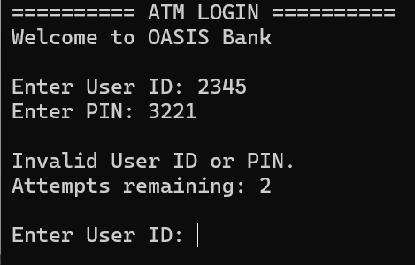
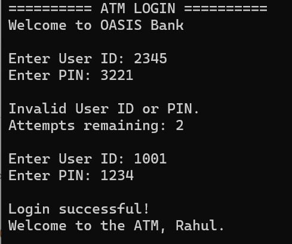
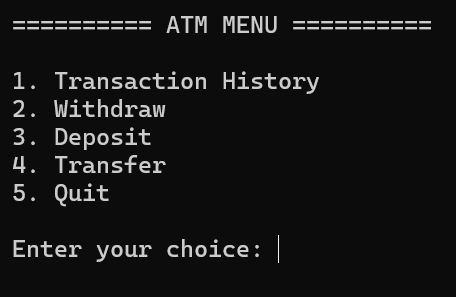
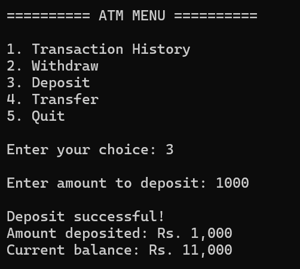
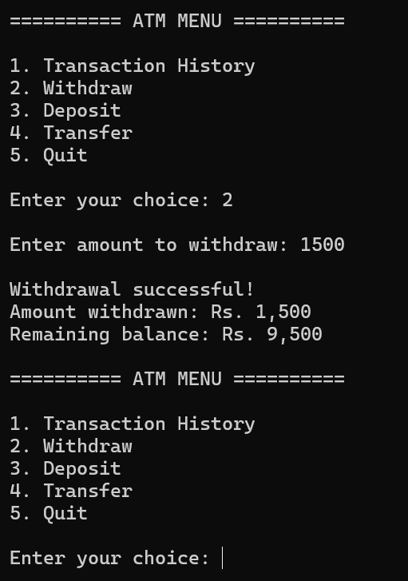
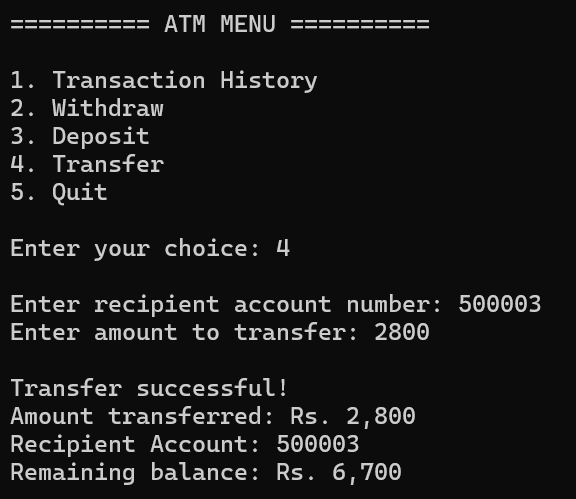
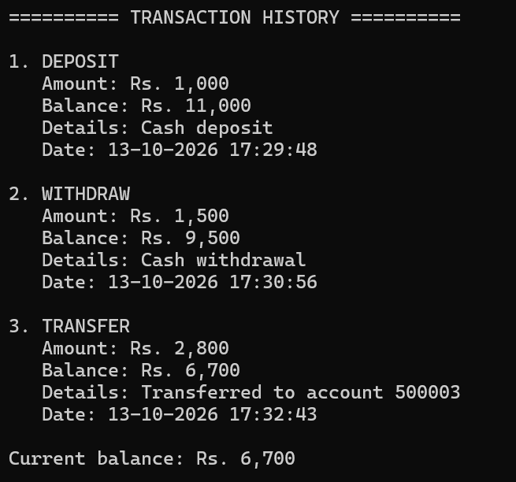
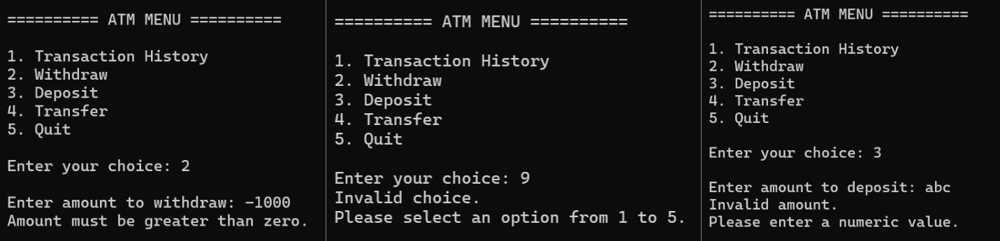
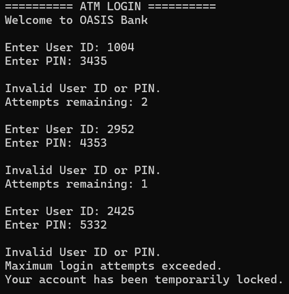
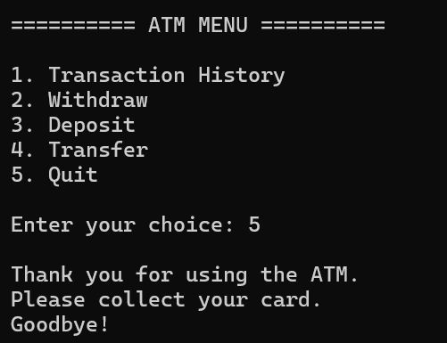

# ATM Interface

**Internship:** OASIS INFOBYTE — Java Development
**Task:** Task 3 — ATM Interface

## Description

A console-based ATM simulator written in Core Java using Object-Oriented Programming.
A customer logs in with a User ID and PIN (maximum 3 attempts), then can view their
transaction history, withdraw, deposit, transfer money to another account, or quit.
The project is split into focused classes (`Main`, `ATM`, `Bank`, `Account`, `Transaction`)
that work together, instead of one large program.

## Features

- **Authentication** — User ID + PIN verified through the `Bank` and `Account` objects
- **Maximum 3 login attempts** — the program ends after the third failure; the menu is never reached
- **Transaction History** — every successful deposit, withdrawal and transfer is stored in an `ArrayList<Transaction>`
- **Withdraw** — validates amount and available balance
- **Deposit** — validates amount
- **Transfer** — validates recipient account, amount and balance; both accounts are updated and both histories record it
- **Balance management** — the balance can never become negative
- **Input validation** — letters, negative numbers, zero, invalid menu choices and unknown accounts are handled without crashing
- **Quit** — exits cleanly with a goodbye message

## Technologies

- Java (Core Java, JDK 11 or newer; developed and tested on JDK 21)
- Object-Oriented Programming (encapsulation, abstraction, composition, association)
- `ArrayList`
- `Scanner`
- Exception handling

No database, JDBC, Swing, JavaFX or external frameworks are used.

## How to Run

1. Install a JDK (11 or newer) and check it works:
   ```
   java -version
   javac -version
   ```
2. Open a terminal in the project folder (`Java-Task3-ATMInterface`).
3. Compile all source files into an `out` folder:
   ```
   javac -d out src/*.java
   ```
4. Run the program:
   ```
   java -cp out Main
   ```

**Windows tip:** if the ₹ symbol appears as `?`, run `chcp 65001` in the terminal first.
In an IDE (IntelliJ / Eclipse / VS Code) just open the `src` folder and run `Main.java`.

## Sample Credentials

These are **sample test accounts** created in `Main.java` and can be changed freely.

| User ID | PIN  | Account Number | Name  | Initial Balance |
|---------|------|----------------|-------|-----------------|
| 1001    | 1234 | 500001         | Rahul | ₹10,000         |
| 1002    | 5678 | 500002         | Aman  | ₹15,000         |
| 1003    | 4321 | 500003         | Priya | ₹20,000         |

The initial balances are set in `Main.createBankWithSampleAccounts()`.
Data is kept in memory only, so balances reset every time the program starts.

## Project Structure

```
Java-Task3-ATMInterface/
├── src/
│   ├── Main.java          Entry point: creates the Bank with sample accounts and starts the ATM
│   ├── ATM.java           User interface: login, menu (switch), input reading and validation, output
│   ├── Account.java       One customer account: private data, balance rules, deposit/withdraw/transfer, history list
│   ├── Transaction.java   One immutable history record: type, amount, balance after, description, date/time
│   └── Bank.java          Stores all accounts, finds accounts, authenticates users, coordinates transfers
├── screenshots/           Screenshots of the running program (+ sample console output text files)
└── README.md
```

**Relationships:** `Bank` manages many `Account`s → each `Account` contains an `ArrayList<Transaction>` →
`ATM` interacts with `Bank` and the logged-in `Account`. `Main` only wires the objects together.

## Screenshots

### 1. Login


### 2. Successful Login


### 3. ATM Menu


### 4. Deposit


### 5. Withdraw


### 6. Transfer


### 7. Transaction History


### 8. Error Handling


### 9. Maximum Login Attempts


### 10. Quit


The `.txt` files already in `screenshots/` are real console output captured from test runs and
can be used as a reference for what each screen should look like.

## Author

*Zishan Khan* — OASIS INFOBYTE Java Development Intern
